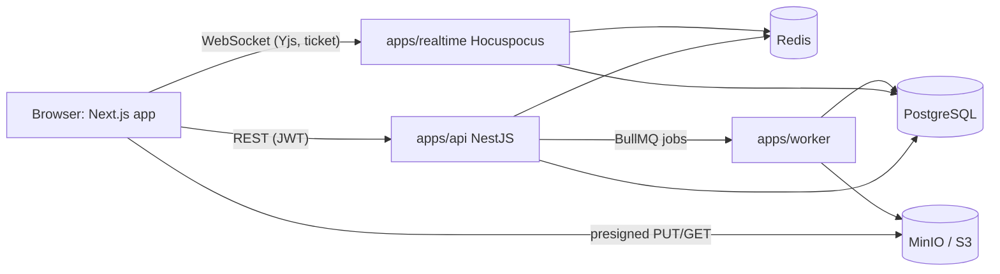

# 01 — ARCHITECTURE



## Monorepo
```
nova/
├─ apps/
│  ├─ web/          Next.js 15 (App Router), TS, Tailwind, shadcn/ui
│  ├─ api/          NestJS 11, Prisma, Zod
│  ├─ realtime/     Hocuspocus server (Node 22)
│  └─ worker/       BullMQ workers: thumbnail, image processing, export PNG
├─ packages/
│  ├─ shared/       Zod schemas, DTO, enums Role/Permission, errors, constants
│  ├─ editor-core/  Document model (Yjs), commands, selection, history, geometry, snapping — headless
│  ├─ editor-konva/ Renderer adapter Konva ↔ editor-core
│  ├─ ui/           Design system (shadcn), tokens
│  └─ config/       eslint, tsconfig, tailwind preset
├─ infra/           docker-compose.yml, Dockerfiles, nginx/caddy
├─ harness/         (xem AGENTS.md)
└─ docs/nova/
```

## Stack (khoá phiên bản major)
| Lớp | Công nghệ |
|---|---|
| Package | pnpm 9, Turborepo, Node 22 LTS |
| Frontend | Next.js 15, React 19, TypeScript 5, Tailwind 4, shadcn/ui, TanStack Query, Zustand (UI state) |
| Canvas | Konva 9 + react-konva (chỉ trong `editor-konva`) |
| Realtime | Yjs, @hocuspocus/server + provider, y-protocols awareness |
| Backend | NestJS 11, Prisma 6, PostgreSQL 16, Zod, pino |
| Queue/Cache | Redis 7, BullMQ |
| Storage | MinIO (dev) / S3 (prod), `@aws-sdk/client-s3` |
| Image | sharp (worker), `@napi-rs/canvas` hoặc Konva-node cho export server (tuỳ chọn) |
| Test | Vitest, Supertest, Playwright |
| Deploy | Docker Compose, GitHub Actions |

## Nguyên tắc
1. **Editor-core headless**: toàn bộ logic chỉnh sửa test được trong Node không cần trình duyệt → tái dùng cho Tauri/Electron sau này.
2. **Renderer adapter**: interface `Renderer` trong core; Konva là một implementation (có thể thay bằng PixiJS/WebGL/Skia).
3. **Media không đi qua realtime**: upload thẳng S3; doc chỉ giữ `assetId`.
4. **Nguồn sự thật**: metadata (user, project, quyền) ở Postgres qua API; nội dung canvas ở Yjs doc (persist Postgres `bytea`).
5. **Stateless services**: api/realtime scale ngang; Hocuspocus dùng `@hocuspocus/extension-redis` khi > 1 instance.

## Luồng mở project
1. Web gọi `GET /projects/:id` (kiểm quyền) → nhận metadata + role.
2. Web gọi `POST /projects/:id/realtime-ticket` → JWT 60s `{sub, projectId, role}`.
3. Web mở `HocuspocusProvider(name = "project:<id>", token = ticket)`.
4. Realtime `onAuthenticate` verify ticket; `onLoadDocument` nạp state từ Postgres.
5. editor-core bind vào `Y.Doc`; editor-konva render.
